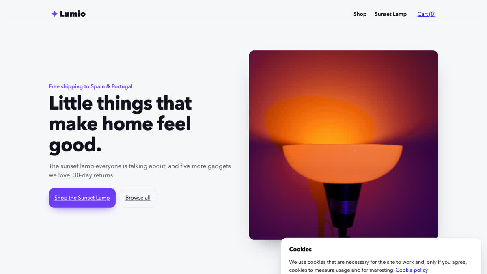
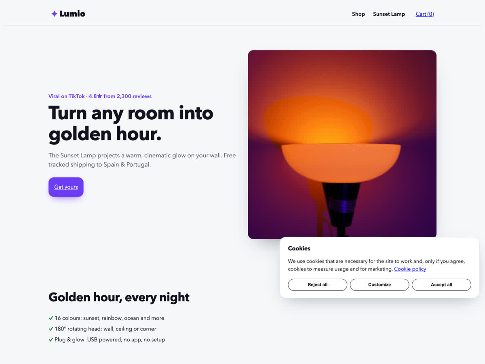
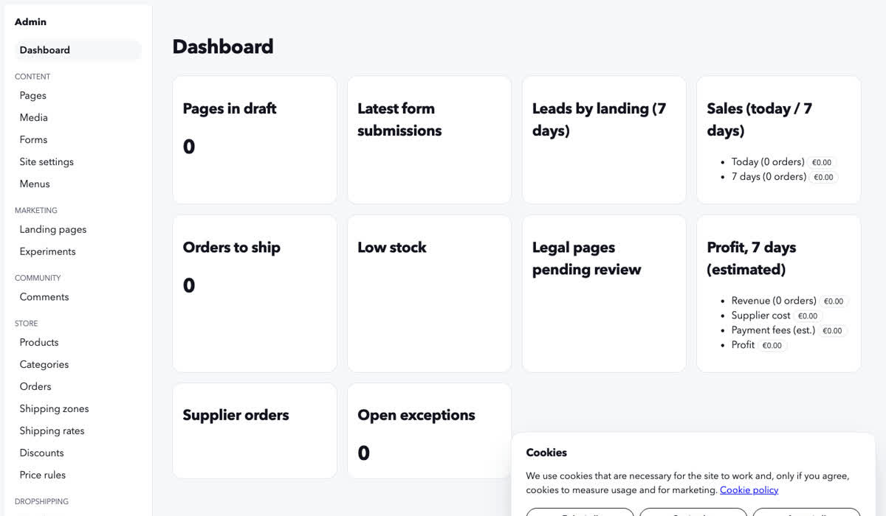

# Lumio · GenPM dropshipping demo

**A complete dropshipping store built with one command:**

```bash
genpm add @core/kit-dropshipping
```

[GenPM](https://genpm.net) injected **37 modules as source code you own**: catalog with variants, cart, Stripe checkout,
orders, shipping zones, discounts, verified reviews, suppliers (CSV + email), margin-based pricing, single-product
landing pages with *buy now*, consent-gated pixels (GA4, Meta, TikTok), A/B tests, an admin panel and a profit widget.
Every module ships an `AGENTS.md`, so your AI agent (Claude Code, Cursor, Copilot…) knows how to wire it up.

> Fictional store. Product photos from [Unsplash](https://unsplash.com) (Unsplash License). [Español abajo](#español).



| Product landing (`/p/sunset-lamp`) | Admin: profit, suppliers, margins |
|---|---|
|  |  |

## How the dropshipping flow works

1. **Margin rule** (`Admin → Price rules`): cost × 2.6, charm rounding to `.90`, never below a 30 % margin.
2. **Supplier** with the `manual` adapter (`Admin → Suppliers`): no API needed; orders go to the supplier by email,
   tracking is entered in the admin. API adapters (CJdropshipping) read credentials from env vars.
3. **Catalog from the supplier's CSV** ([`scripts/supplier-catalog.csv`](scripts/supplier-catalog.csv)): costs in USD are
   converted to EUR, selling prices come from the rule, photos go to the media library, real delivery estimates come
   from the supplier's shipping days. The Sunset Lamp costs $8.40 and sells for €20.90.
4. **Selling**: a landing page per hero product with *buy now* straight to Stripe Checkout, delivery dates and EU
   import notices *before* payment, cart with free shipping to Spain & Portugal.
5. **After the sale**: paid orders appear in *Supplier orders* (approve or forward automatically), tracking emails the
   customer, and the dashboard estimates profit after supplier cost and payment fees.

## How it was built (the commits tell the story)

1. `npx create-next-app@latest` → empty Next.js 16 project.
2. `genpm add @core/kit-dropshipping` → 37 modules injected and pinned by commit SHA in `genpm.lock`.
3. Integration following each kit's `AGENTS.md` (kit-cms → kit-store → kit-landing → kit-dropshipping): config, env,
   auth routes, `src/genpm/*` registration files, proxy, migrations, layout with cart and cookie banner.
4. The store itself: theme (`src/app/theme.css`) and demo content (`scripts/seed-demo.mts`).

## Run it locally

You need Node 20+, Docker (or any Postgres), a [GitHub OAuth app](https://github.com/settings/developers) for the admin
(callback `http://localhost:3000/auth/callback/github`) and Stripe **test** keys to complete a purchase.

```bash
git clone https://github.com/GenPM-net/demo-dropshipping && cd demo-dropshipping
npm install
docker run -d --name lumio-pg -e POSTGRES_PASSWORD=dev -p 5432:5432 postgres:17-alpine
cp .env.example .env.local      # DATABASE_URL, AUTH_SECRET, GITHUB_*, STRIPE_* (test), secrets, STORAGE_DRIVER=local
node --env-file=.env.local node_modules/drizzle-kit/bin.cjs migrate --config src/lib/db/drizzle.config.ts
npx tsx --env-file=.env.local scripts/seed-demo.mts
npm run build && npm start
stripe listen --forward-to localhost:3000/api/stripe/webhook     # in another terminal
```

Sign in at `/admin/login` and make yourself the owner:
`npx tsx --env-file=.env.local "src/app/(cms)/_scripts/create-owner.ts" you@example.com`.
Buy with the test card `4242 4242 4242 4242` and watch the order land in *Supplier orders*.

## Start your own

```bash
npx create-next-app@latest my-store && cd my-store
curl -fsSL https://genpm.net/install.sh | sh
genpm add @core/kit-dropshipping
```

Or ask your AI: run `genpm mcp setup` once, then *"set up a dropshipping store with genpm"*.
Just a store without suppliers? `@core/kit-store`. Lead-gen landings? `@core/kit-landing`. Catalog: [genpm.net](https://genpm.net).

---

## Español

**Una tienda de dropshipping completa con un comando: `genpm add @core/kit-dropshipping`.** GenPM inyecta 37 módulos
como código tuyo: catálogo, carrito, checkout de Stripe, pedidos, envíos, cupones, reseñas, proveedores por CSV, precios
por margen, landings de producto con compra directa, píxeles con consentimiento, tests A/B, panel y beneficio estimado.
Los commits muestran cada paso. Pruébala en local con los comandos de arriba. Tienda ficticia; fotos de Unsplash.

## License

MIT. The modules in `src/lib` and `src/app/(…)` are MIT as well (see each `LICENSE`).
